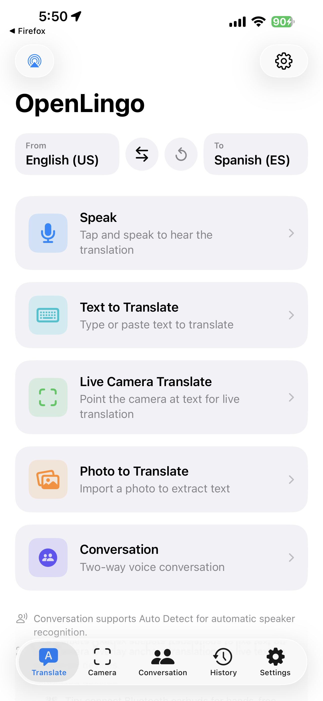
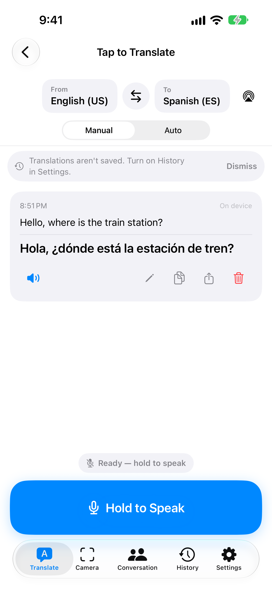
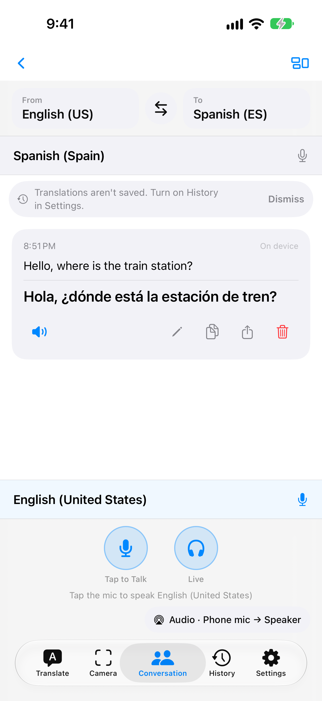
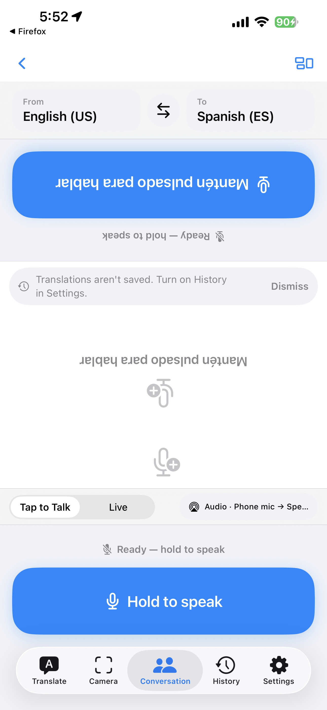
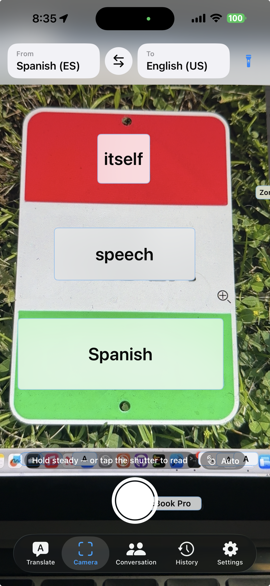
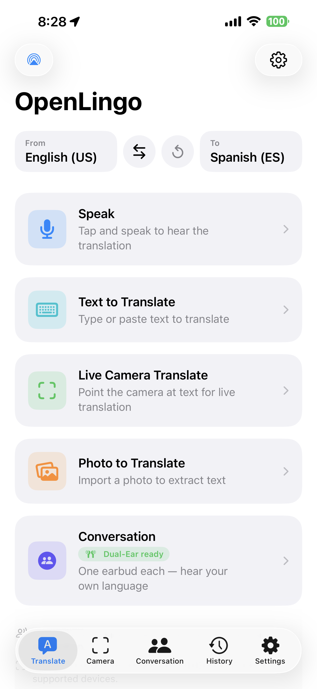

# Talk Anywhere

Talk Anywhere is an iOS translator that runs on your phone. It speaks, types,
reads text through the camera, and turns ordinary Bluetooth earbuds into
real-time translation earbuds: two people take one earbud each and hear only
their own language.

Speech is captured, transcribed, translated, and spoken back on device whenever
the selected speech and translation models support it. There are no accounts,
no analytics, and nothing to pay for.

## Join the beta on TestFlight

**[Join the Talk Anywhere beta](https://testflight.apple.com/join/ECzs4YdM)**

1. Install [TestFlight](https://apps.apple.com/app/testflight/id899247664) from the App Store.
2. Open the link above on your iPhone and tap **Accept**, then **Install**.
3. Builds expire after 90 days; TestFlight will prompt you when a new one is available.

Current build: **0.4.17 (85)**. Requires iOS 18 or later. Screenshots below are from build 82 (iPhone 17 Pro Max simulator; the Live Camera shot is from an iPhone 15 Pro Max).

### What's new in 0.4.17

- **Conversation stays smooth while people talk.** The transcript no longer redraws every turn each time a partial transcript arrives, and the first press of a session arms faster.
- **Live is more careful with the microphone.** After a phone call that iOS ends with "don't resume", Live parks as Paused with the mic released instead of keeping it open. Pressing Stop while your earbuds disconnect keeps the sentence you were saying, and playback stops when you leave the screen.
- **Changing languages mid-conversation** no longer risks a dead first press, and shows the "no voice input" notice for the new pair when it applies.
- **The earbud-microphone suggestion** now appears in Tap-to-Talk when it should.

### What's new in 0.4.16

- **Live Camera is faster.** The first text you point at no longer waits for the recognizer and the translator to warm up; both are ready before the preview starts. Text recognition backs off while translations are running so the two stop slowing each other down, and blocks that only flash past during a pan are no longer sent for translation.
- **Live Camera boxes stay on the text.** Boxes follow a slow pan instead of trailing it, and the translation of small, tightly spaced print no longer overlaps the line below.
- **Language picker** shows full language names ("English — United Kingdom") instead of cutting them off.

## What it does

| Translate | Speak | Conversation |
|---|---|---|
|  |  |  |

| Face to face | Live camera | Dual-ear earbuds |
|---|---|---|
|  |  |  |

- **Translate**: type or tap to speak, hear the result read aloud.
- **Camera**: point at signs or menus and read the translation live on screen.
- **Conversation**: side-by-side or face-to-face layouts, with hands-free Live mode that detects who is speaking.
- **Dual-ear**: one earbud each, every person hears only their own language.
- **Offline**: Apple, Google ML Kit, Whisper, and a bundled M2M-100 pack let most pairs work with no network.

## Feedback

Shake the device inside TestFlight, or open an [issue](../../issues) here.

## Source code

The source is not published in this repository.
